# Analysis and Design of a Smart Physical Retail Store Using the Dunnhumby Dataset

Bachelor's final project in Computer Engineering, Department of Computer Engineering, Faculty of
Electrical and Computer Engineering, University of Kashan. Supervised by Dr. Vahidipour, September 2026.

**Developers:**

| Name | Student ID | GitHub |
|---|---|---|
| Sina Mozaffari Rad | 40021160214 | [@Sinamozaffarirad](https://github.com/Sinamozaffarirad) |
| Fatemeh Sadat Dastyafteh | 40021160014 | [@fatemehdsf82](https://github.com/fatemehdsf82) |
| Samaneh Tabandeh | 40021160009 | [@sm2003t](https://github.com/sm2003t) |

**Full report (in Persian, 221 pages):** [`report/Project_Report.pdf`](report/Project_Report.pdf)

<p align="center">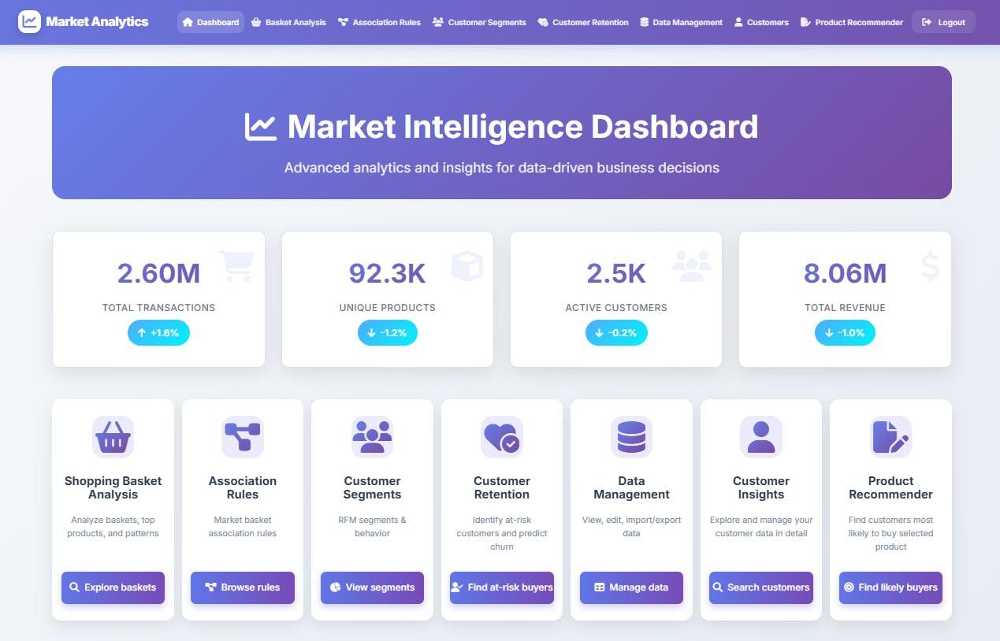</p>

## Overview

A physical store records every purchase, but the transaction log alone does not tell a manager which
products are bought together, which customers are about to stop shopping, or what to offer to whom.
This project builds a web-based decision-support system on top of the Dunnhumby *The Complete Journey*
dataset that turns two years of household-level transactions into those answers.

The system is a Django application backed by SQL Server. It brings together descriptive analysis,
association rule mining, predictive models, a business intelligence dashboard with statistical
group comparisons, RFM segmentation, churn prediction, retention prioritisation and a hybrid product
recommender. All pages share the same household, basket and product identifiers, so a user can move
from a store-level chart to one customer's history and the products recommended to that customer.

The contribution of the project is not a new algorithm. It is the implementation and evaluation of
several established methods inside one connected system, with attention to time-based validation and
to what each result can and cannot be used for.

## Contents

- [Dataset](#dataset)
- [System modules](#system-modules)
- [Methods](#methods)
- [Results](#results)
- [Screenshots](#screenshots)
- [Architecture and technology](#architecture-and-technology)
- [Repository layout](#repository-layout)
- [Running the project](#running-the-project)
- [Limitations](#limitations)
- [Report structure](#report-structure)
- [License](#license)

## Dataset

The project uses [Dunnhumby – The Complete Journey](https://www.dunnhumby.com/source-files/), a
public dataset of household purchases from one retailer. After cleaning and loading into SQL Server,
the data used by the system is:

| Measure | Unit | Value |
|---|---|---|
| Transaction rows | purchased line items | 2,595,277 |
| Baskets | unique basket IDs | 276,450 |
| Households | unique household keys | 2,497 |
| Products bought | unique product IDs in transactions | 92,335 |
| Product reference table | records | 92,353 |
| Stores | unique store IDs | 582 |
| Time span | dataset days | 1 – 711 |
| Total sales | USD | 8,056,068.52 |

Preparation steps (Chapter 2 of the report): standardising column names and null values, checking the
sales-value convention of each transaction, standardising product size text, checking identifier
uniqueness and duplicates, and verifying that every transaction refers to an existing household and
product. Time in the dataset is given as day and week numbers, not calendar dates, so no results are
tied to real holidays or seasons.

## System modules

| Module | Path | Purpose |
|---|---|---|
| Home | `/analysis/` | Key figures (transactions, products, households, revenue) with period-over-period comparison and links to every section |
| Basket analysis | `/analysis/basket-analysis/` | Descriptive analysis, department/commodity association rules, repurchase prediction and product revenue forecasting |
| Association rules | `/analysis/association-rules/` | Product-level rule mining with detail view and saving of selected rules to the database |
| BI dashboard | `/analysis/bi-dashboard/` | Seven dashboard pages with cross-filtering, plus a statistical significance testing page |
| Customer segments | `/analysis/customer-segments/` | RFM segments, churn experiment configuration and churn risk overview |
| Customer retention | `/analysis/customer-retention/` | Prioritised list of households for retention action |
| Customers | `/customers/search/` | Customer search, profile, purchase history and per-customer churn analysis |
| Product recommender | `/analysis/product-recommender/` | Products for a customer, and likely customers for a product or category |
| Data management | `/analysis/data-management/` | Browsing and maintenance of the dataset tables |

## Methods

### Descriptive analysis and association rules

High-value baskets and products are ranked by transaction count and by revenue. Association rules are
mined at department, commodity and product level and reported with support, confidence and lift. The
product-level implementation follows the Apriori idea in SQL: the relative support threshold is turned
into a minimum basket count, item pairs are counted with a self-join on the transaction table, candidates
are kept by lift, and product descriptions are attached before the final ranking. Selected rules can be
stored in the database and are reused by the recommender.

### Repurchase prediction

The question is whether a household will buy again from a department it already buys from within a
given horizon (1 to 4 months). Samples are built at several cut-off days. Features come only from the
history before the cut-off, the label from the window after it, and a gap separates the training and test
periods so that no future information leaks into training. A random split is deliberately not used.
Four classifiers are compared on the same chronological holdout: a neural network (MLP), random forest,
gradient boosting and a support vector machine.

### Product revenue forecasting

Revenue per product is aggregated into complete 30-day periods. Two models are trained and compared
against a recent-average baseline on an identical holdout:

- an encoder–decoder recurrent network that forecasts several periods recursively, and
- an independent direct model.

Forecasts are made in log space with a back-transformation correction and reconciled with the forecast
of total revenue. The system rejects window and holdout combinations that do not leave enough history
for leakage-free training. Evaluation uses MAE, RMSE, WMAPE, sMAPE, R², Spearman and Kendall rank
correlation, and Top-K precision, recall, Jaccard and NDCG.

### Business intelligence and differential analysis

The BI dashboard has an overview, products, time and trading patterns, customers, stores, growth and
loyalty, pricing and promotions, and a significance testing page. Charts filter each other on click.
On the significance page, two groups (for example two RFM segments) are compared with six tests:
Mann–Whitney U, Kolmogorov–Smirnov, chi-square, Welch's t-test, one-way ANOVA and Kruskal–Wallis.
Each test is reported with an effect size (Cliff's delta, Cramér's V, Cohen's d, eta squared, epsilon
squared), and p-values are adjusted with the Benjamini–Hochberg procedure. An automatic search ranks
the largest differences between groups and ranks grouping dimensions by the share of variance they
explain.

### RFM segmentation, churn and retention

Households are scored on recency, frequency and monetary value and assigned to eleven segments
(Champions, Loyal Customers, At Risk, Hibernating and others). Churn is defined as no recorded
purchase in a full future horizon. The churn model is XGBoost trained on sliding observation windows
(90-day observation, 30-day horizon, 30-day step) with separate training, validation and test periods.
The decision threshold is chosen on the validation set. Households are then ranked for retention
action by churn probability together with their value and segment.

### Hybrid recommender

Candidate products for a household come from three sources: stored association rules, collaborative
filtering on household similarity, and the household's own purchase history. A trained ranking model
scores the candidates using behavioural and product features, and business rules are applied afterwards
(purchase cycle, limiting repeated suggestions, and a "new brand discovery" option). The same model is
used in the reverse direction to find likely customers for a product, commodity or department.
The household–product similarity matrix is precomputed, which brought the response time from several
minutes to a fraction of a second.

## Results

Main quantitative results, taken from Table 10-1 of the report. The four problems use different test
sets, so the numbers should not be compared across rows.

| Task | Method | Main metrics | Interpretation |
|---|---|---|---|
| Repurchase (3-month horizon, 29,771 test pairs) | Gradient boosting | ROC-AUC 0.873, F1 0.812, recall 0.820, Brier 0.147 | Best of the four classifiers in this configuration |
| Product revenue (3 × 30-day holdout) | Direct model vs. RNN vs. recent average | WMAPE 46.0 % vs. 46.7 % vs. 48.7 % | Direct model lowers WMAPE by 2.7 points, but the baseline is better on RMSE, R² and bias |
| Top-20 revenue ranking | All three methods | 16 of the actual top 20 products found | Little difference between methods for identifying the main products |
| Churn (90/30/30-day windows) | XGBoost, threshold 0.30 | ROC-AUC 0.882, PR-AUC 0.606, recall 0.673, F1 0.602 | Useful for ranking households to review; about 54.5 % of alerts are correct |
| Product recommendation | Hybrid model | ROC-AUC 0.627, PR-AUC 0.032 (positive rate 1.84 %) | Limited separation; quality of the final top-20 lists is not yet measured |

Some descriptive findings from the BI dashboard (Chapter 6):

- The median basket has 5 items and about 22 % of baskets contain a single item; a small number of
  large baskets pulls the mean above the median.
- The top two household deciles generate 53.1 % of revenue.
- In the churn test set, 929 churners were found, 451 were missed, 775 alerts were false and 5,336
  non-churners were correctly identified. A more complex model did not always give a better result,
  and each method had to be judged with the metric that matches its use.

## Screenshots

All screenshots are from the running system and are also used in the report.

### Basket analysis and association rules

| | |
|---|---|
| 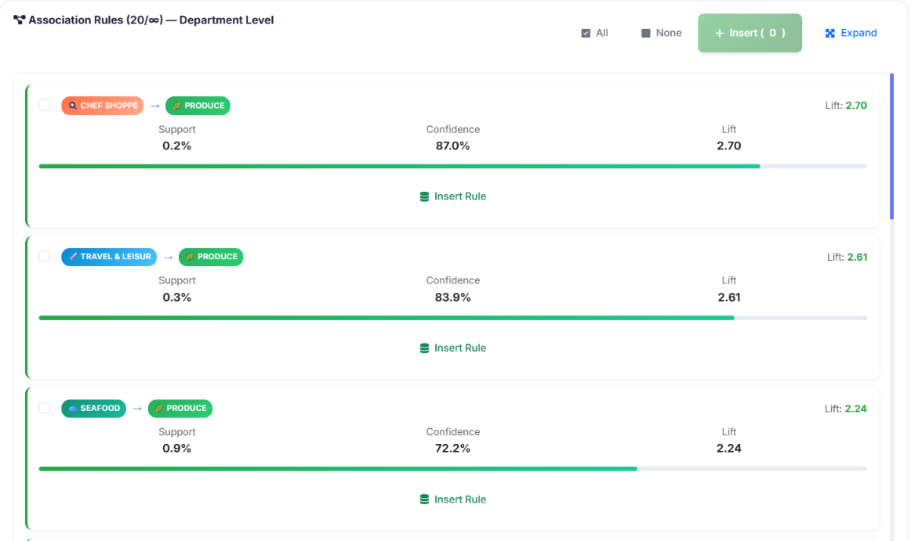 | 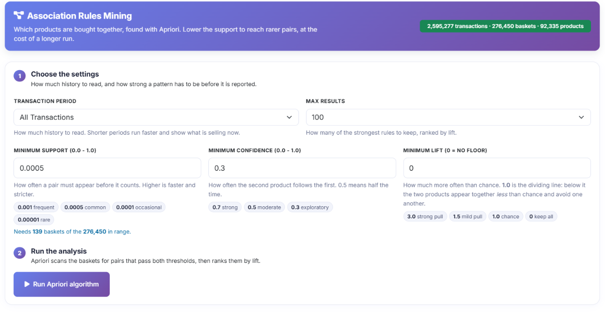 |
| Department-level rules with support, confidence and lift | Product-level rule mining settings |
| 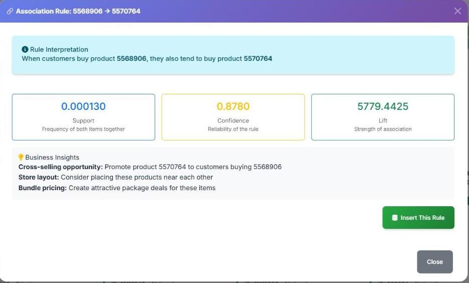 | 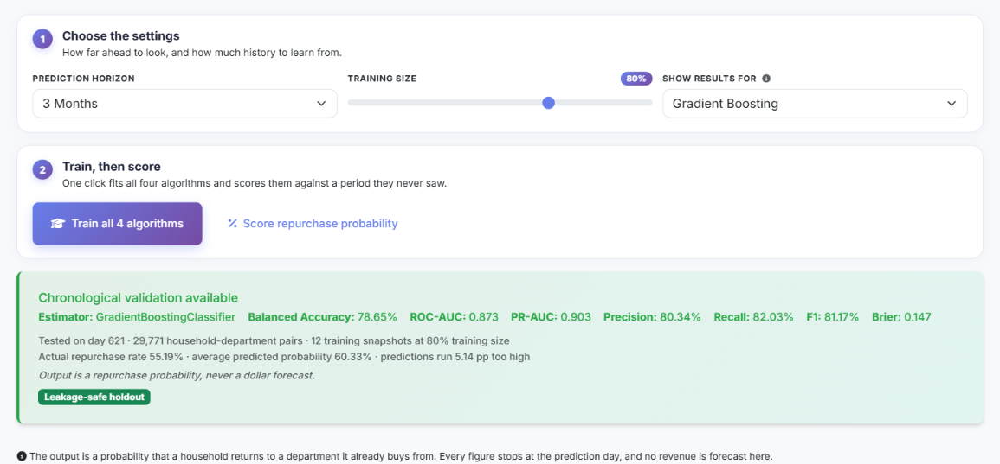 |
| Rule detail with suggested business actions | Repurchase classifier settings and chronological validation |

### Revenue forecasting

<p align="center">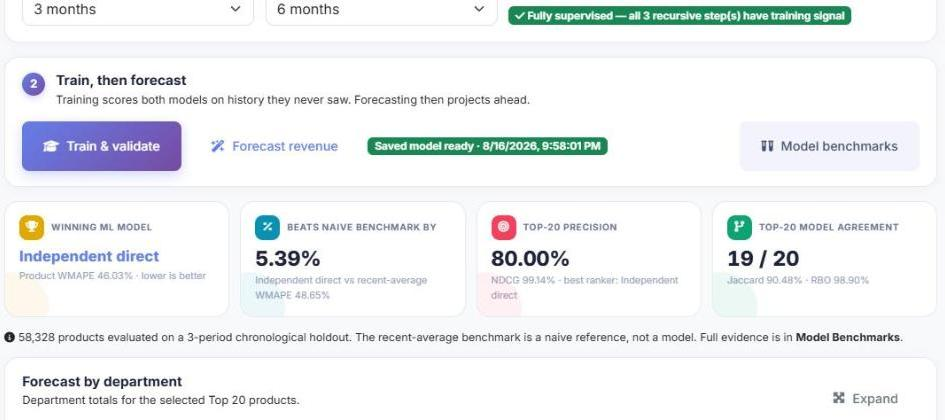</p>

### Business intelligence dashboard

<p align="center">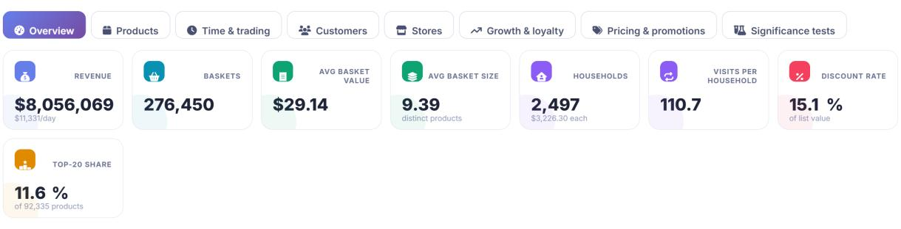</p>

| | |
|---|---|
| 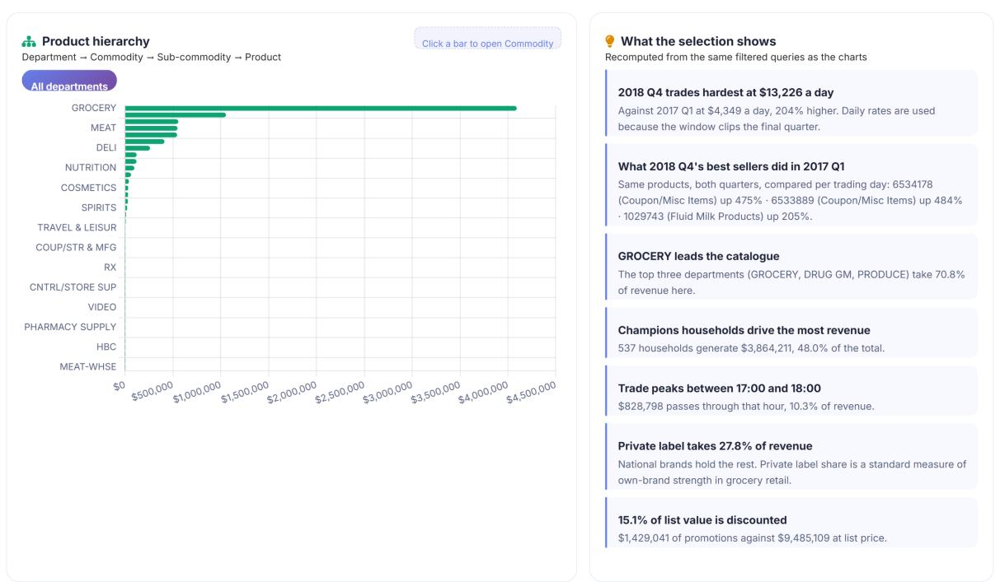 | 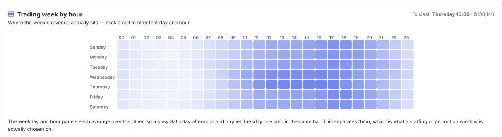 |
| Product hierarchy and automatic insights | Revenue by weekday and hour |
| 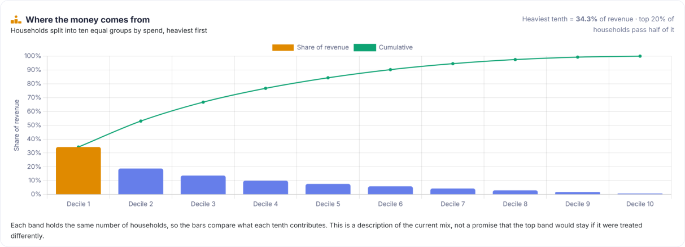 | 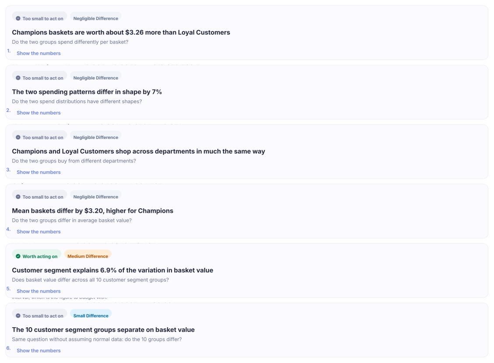 |
| Share of revenue by household decile | Significance tests between two segments |

### Customers, churn and retention

| | |
|---|---|
| 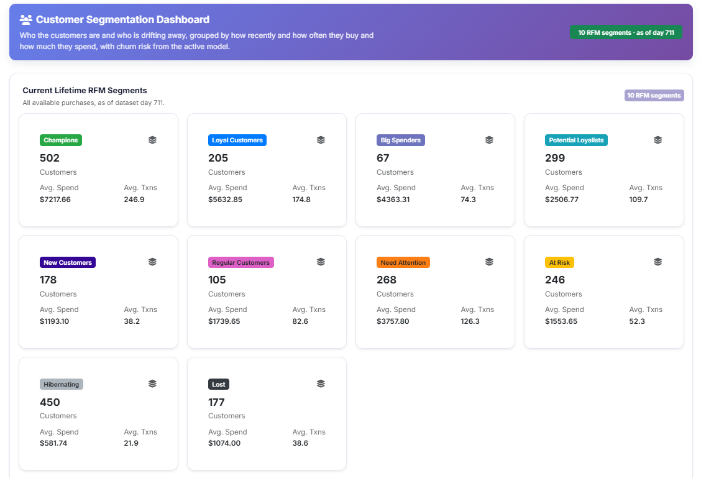 | 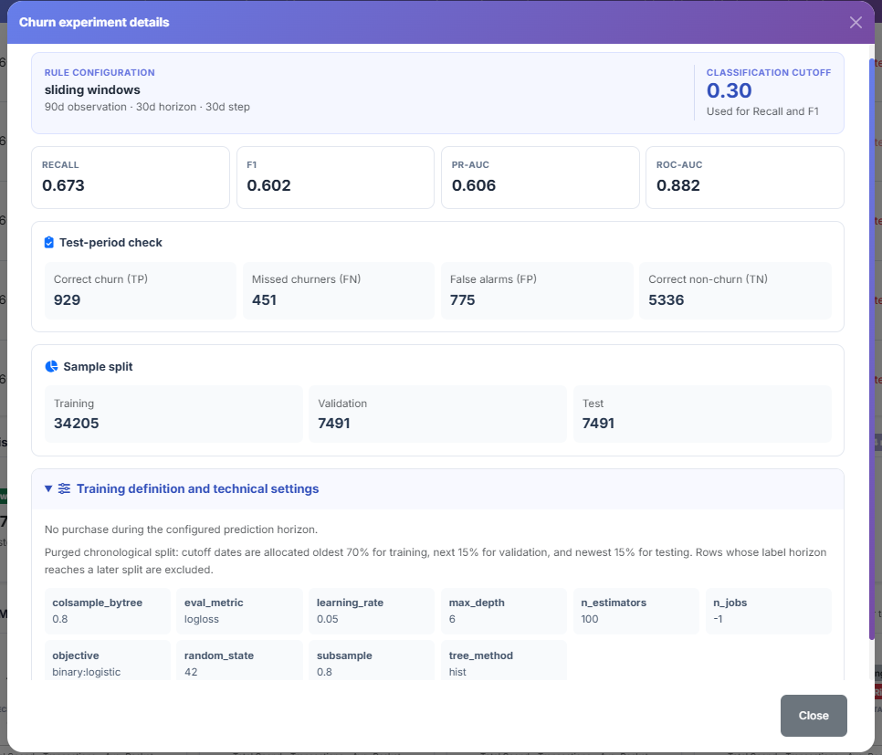 |
| RFM segmentation dashboard | Churn experiment details and test metrics |
| 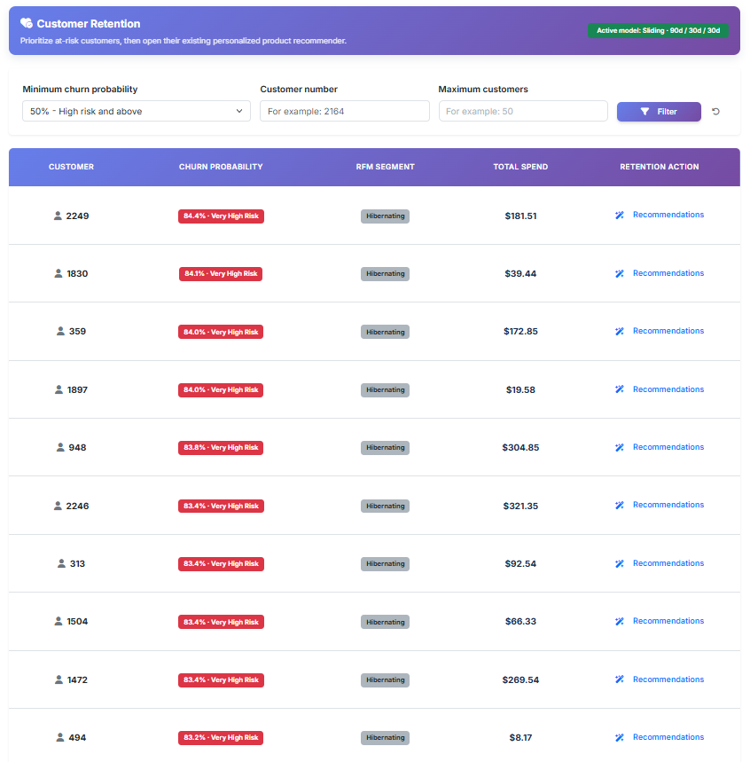 | 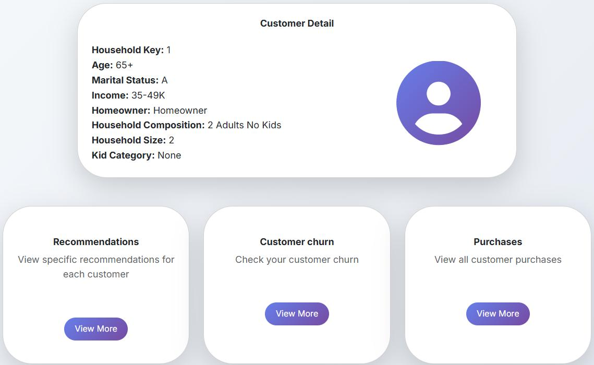 |
| Retention priority list | Customer profile |

### Recommendations

| | |
|---|---|
| 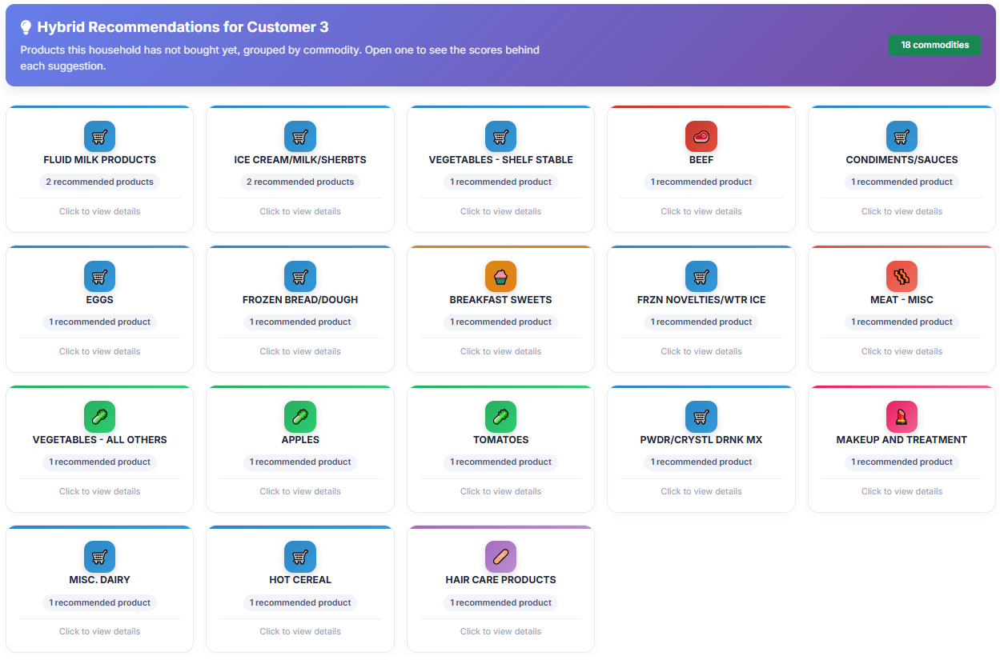 | 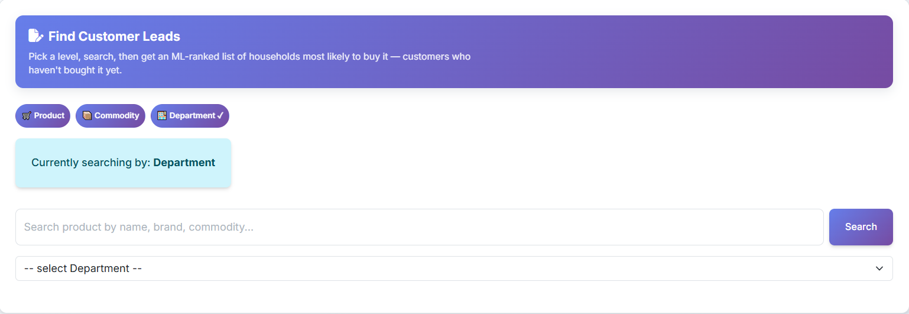 |
| Recommendations for a household, grouped by commodity | Finding likely customers for a product or category |

## Architecture and technology

- **Back end:** Python, Django 5.2, SQL Server through `mssql-django` and `pyodbc`. Large dataset tables
  are unmanaged Django models queried with optimised SQL.
- **Data and models:** pandas, NumPy, SciPy, scikit-learn, XGBoost. Trained models are versioned and
  cached in `webapp/ml_models_cache/` so that results can be reused without retraining.
- **Front end:** Django templates, Bootstrap 5, Chart.js.
- **Reporting:** a published Power BI report embedded in the system through its URL (`POWER_BI_EMBED_URL`).
- **Access control:** all analysis pages require login; settings such as the secret key, debug mode and
  database connection are read from environment variables.

## Repository layout

```
webapp/                      Django project
  manage.py
  market/                    Project settings and URL configuration
  core/                      Home page and shared models
  dunnhumby/                 Basket analysis, association rules, forecasting, BI dashboard, churn
  customers/                 Customer search, profile, purchases, recommender model
  customer_retention/        Retention prioritisation
  product_recommender/       Product-to-customer recommendations
  catalog/                   Product catalogue
  ml_models_cache/           Trained models loaded by the pages
  templates/, static/        Shared templates and assets
report/Project_Report.pdf    Final project report (Persian)
docs/SETUP.md                Detailed setup, configuration and maintenance commands
docs/screenshots/            Images used in this README
scripts/                     Demonstration scripts (local server with an optional public tunnel)
tests/chart_hover/           Front-end check for chart hover behaviour
requirements.txt             Python dependencies
```

## Running the project

Requirements: Python 3.11 or newer, Microsoft SQL Server and ODBC Driver 17 for SQL Server, on Windows.

```powershell
python -m venv .venv
.\.venv\Scripts\python.exe -m pip install -r requirements.txt
```

The dataset tables are not created by migrations. Download the Dunnhumby dataset, load it into a SQL
Server database named `marketdb` (or restore a backup of it), then configure and start the site:

```powershell
$env:DJANGO_SECRET_KEY = & .\.venv\Scripts\python.exe -c "from django.core.management.utils import get_random_secret_key; print(get_random_secret_key())"
$env:DB_HOST = 'localhost'
$env:DB_NAME = 'marketdb'
.\.venv\Scripts\python.exe webapp\manage.py migrate
.\.venv\Scripts\python.exe webapp\manage.py createsuperuser
.\.venv\Scripts\python.exe webapp\manage.py runserver
```

Open `http://127.0.0.1:8000/analysis/` and log in. The full guide, including the model cache, tests and
demonstration scripts, is in [`docs/SETUP.md`](docs/SETUP.md).

## Limitations

- Results are limited to this dataset. The customer unit is a household, time is given as day and week
  numbers, and demographic information is incomplete.
- Recorded revenue is not profit; cost and margin data are not available.
- Churn means no recorded purchase in the horizon. It does not show that a household left permanently
  or bought elsewhere, and the high-risk list is a model score, not confirmed churn.
- Association rules show co-occurrence, not that placing two products together increases sales.
- The effect of recommendations and retention actions on real purchases was not measured; that needs a
  controlled experiment in the store.
- The support vector machine was trained on a smaller subset because of its computational cost, so the
  classifier comparison reflects the configurations that were run.

## Report structure

The report ([`report/Project_Report.pdf`](report/Project_Report.pdf)) is written in Persian and has ten
chapters:

1. Introduction, problem statement, objectives and technical overview
2. Dataset, data preparation and database structure
3. The system and its home page
4. Descriptive basket analysis and association rules
5. Predictive analysis: repurchase classification and product revenue forecasting
6. Business intelligence dashboard and differential analysis
7. Product-level association rule mining
8. Analytical dashboard, churn analysis and retention prioritisation
9. Recommender systems and customer pages
10. Conclusions and future work

## License

The source code is released under the [MIT License](LICENSE). The project report in `report/` and the
screenshots in `docs/` remain the copyright of the developers; please cite the project when using them.
The Dunnhumby dataset is not part of this repository and is subject to Dunnhumby's own terms of use.

## Acknowledgements

The dataset is provided by Dunnhumby and is subject to its own terms of use.
